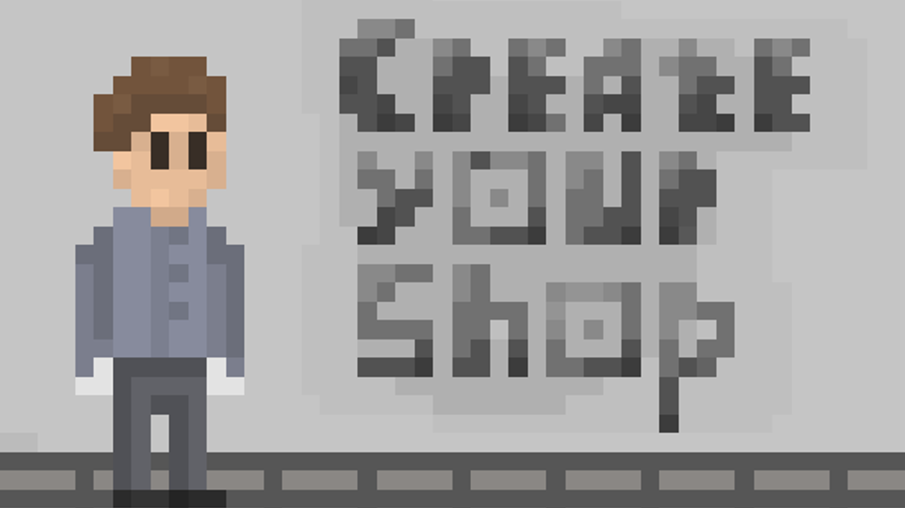
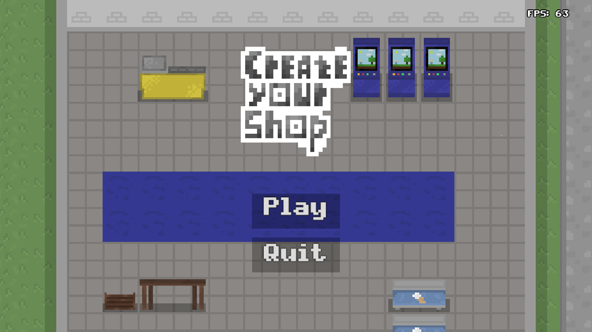
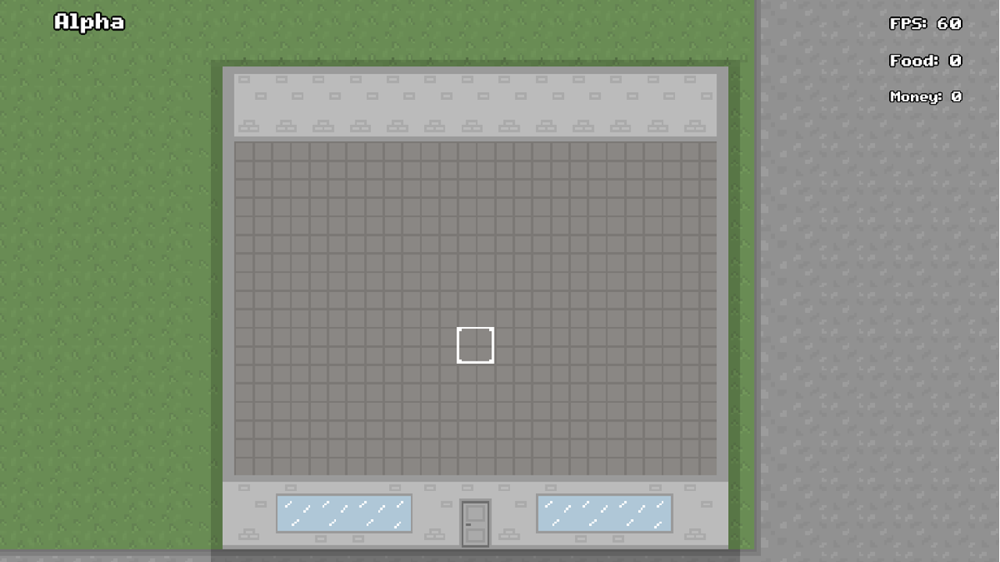
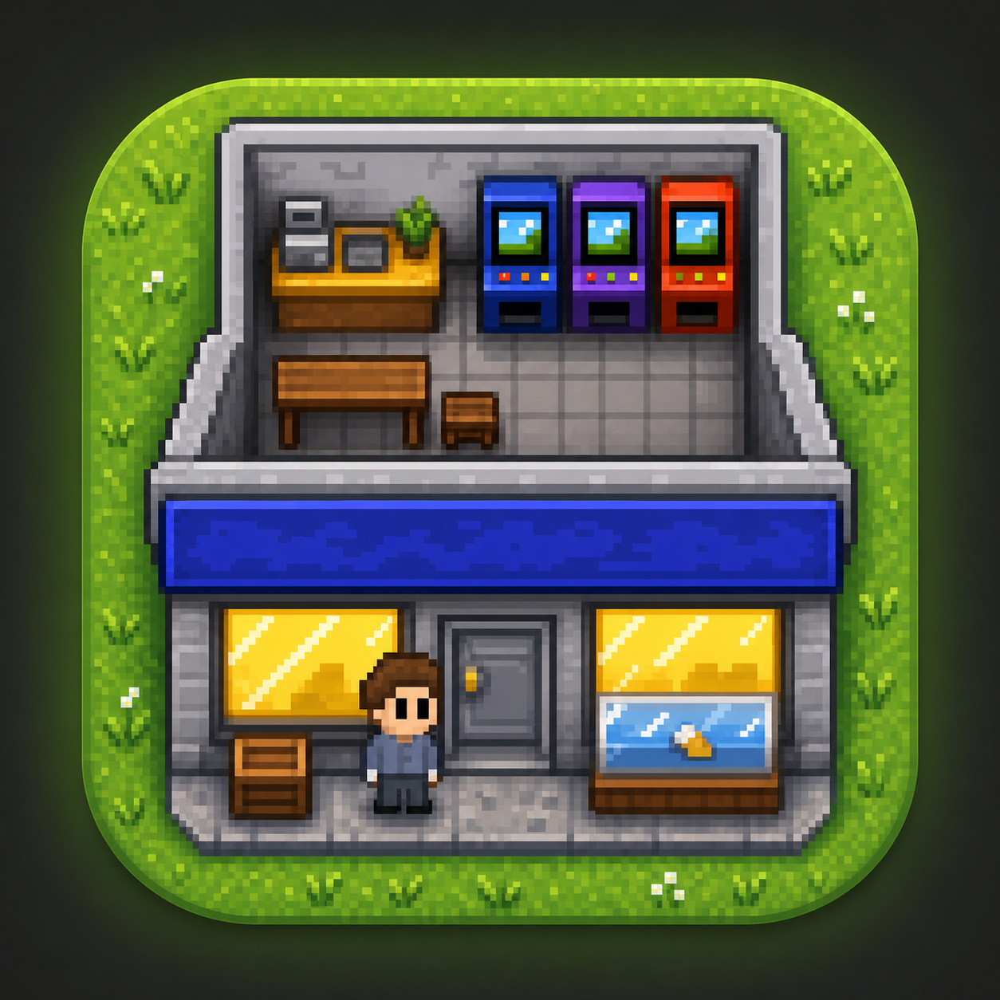

# Create your Shop (CYS)

[English](README.md) · [Русский](README.ru.md)

> **Бета** — игра в активной бете. Возможности могут меняться, баги ожидаемы.

[](LICENSE)


2D-симулятор магазина на Rust поверх `wgpu`. Строй свой магазин: клади пол,
стены и ковры, ставь стеллажи, кассы и декор, пополняй запасы, обслуживай
покупателей и не дай бизнесу разориться.


| | |
|---|---|
|  |  |
|  |  |

## Сборка и запуск

```sh
cargo build --release
cargo run --release
```

Нужен Rust edition 2021 и GPU с Vulkan (Linux/Android) или Dx12 (Windows).
Android — см. [docs/ru/build.md](docs/ru/build.md).

## Управление

| Действие | Ввод |
|---|---|
| Поставить / убрать / использовать | `ЛКМ` или `F` |
| Сменить режим (move/interact/build/delete) | `Tab` или иконка режима |
| Открыть / закрыть инвентарь | `E` |
| Выбрать слот хотбара | Клик по слоту |
| Открыть / закрыть магазин | Клик по иконке active |
| Зум | `Колесо`, `K` / `L`, щипок |
| Двигать камеру (режим `move`) | Drag мышью/пальцем, стрелки |
| Настройки (ставят игру на паузу) | `Esc` / кнопка Back на Android |
| Быстрое сохранение | `Ctrl+S` (загрузка через меню миров) |
| Войти в подвал | Клик по лестнице в подвал |
| В меню | `R` (при банкротстве) |

На Android: тап = клик, перетаскивание одним пальцем двигает камеру только в
режиме `move`, щипок двумя пальцами = зум, системная кнопка Back закрывает
панели или открывает меню паузы. По умолчанию включён `move`; переключись на
interact/build/delete, чтобы работать с миром.

## Возможности

- **Строительство** — пол, стены, ковры, уличный декор, цветы.
- **Объекты** — стеллажи, коробки, кассы, витрина конфет, аркадные автоматы,
  заборы, лестница в подвал и магазин.
- **Покупатели** — A*-поиск пути, очередь к кассе, покупка еды и конфет, вход
  через анимированную дверь.
- **Экономика** — цены, аренда, банкротство, открытый/закрытый магазин,
  покупка доступа к предметам.
- **Мир** — цикл день/ночь с динамическим 2D-освещением, четыре сезона со
  снегом и дождём.
- **Подвал** — второй уровень с переходами в обе стороны и своей картой.
- **Миры** — создание, имя и удаление миров в меню в стиле Minecraft;
  автосохранение при выходе, быстрое сохранение по `Ctrl+S`.
- **Пауза** — настройки замораживают аренду, день/ночь, покупателей и погоду.
- **Настройки** — VSync, скорость зума, музыка и звуки; всё в `settings.json`.
- **Баланс в Lua** — `assets/scripts/config.lua` и `assets/scripts/npc.lua`
  задают тайминги, цены и решения покупателей.

## Документация

Полная документация для разработчиков — в [`docs/`](docs/README.md). Русский
текст основной, английский повторяет его страница в страницу.

| Тема | Русский | English |
|---|---|---|
| С чего начать | [docs/ru/architecture.md](docs/ru/architecture.md) | [docs/en/architecture.md](docs/en/architecture.md) |
| Карта исходников | [docs/ru/source-map.md](docs/ru/source-map.md) | [docs/en/source-map.md](docs/en/source-map.md) |
| Рендеринг | [docs/ru/rendering.md](docs/ru/rendering.md) | [docs/en/rendering.md](docs/en/rendering.md) |
| ECS | [docs/ru/ecs.md](docs/ru/ecs.md) | [docs/en/ecs.md](docs/en/ecs.md) |
| Геймплей | [docs/ru/gameplay.md](docs/ru/gameplay.md) | [docs/en/gameplay.md](docs/en/gameplay.md) |
| Сохранения и карты | [docs/ru/world-format.md](docs/ru/world-format.md) | [docs/en/world-format.md](docs/en/world-format.md) |
| Lua-скрипты | [docs/ru/scripts.md](docs/ru/scripts.md) | [docs/en/scripts.md](docs/en/scripts.md) |
| Ассеты | [docs/ru/assets.md](docs/ru/assets.md) | [docs/en/assets.md](docs/en/assets.md) |
| Сборка | [docs/ru/build.md](docs/ru/build.md) | [docs/en/build.md](docs/en/build.md) |
| Тесты | [docs/ru/testing.md](docs/ru/testing.md) | [docs/en/testing.md](docs/en/testing.md) |
| Участие | [docs/ru/contributing.md](docs/ru/contributing.md) | [docs/en/contributing.md](docs/en/contributing.md) |

Документацию проверяет `cargo test`: страницы RU/EN должны быть в парах,
каждый `.rs` — в карте исходников, блоки кода — совпадать между языками, а все
относительные ссылки — существовать.

## Архитектура

```text
src/
├── main/     — точка входа, App, цикл winit, вход Android
├── core/     — ядро wgpu: пайплайн, текстуры, рендер, шейдеры, свет
├── scenes/   — меню, игровая сцена, менеджер сцен
├── ecs/      — адаптер specs, компоненты, фабрика, группы, курсор
├── data/     — слоты/объекты, размещение, карта, A*, дверь
├── ui/       — HUD, инвентарь, магазин, настройки, погода, текст
├── input/    — камера, курсор, взаимодействие, ПК/тач
├── npc/      — автомат ShopperNpc и движение
├── audio/    — звуковой движок (rodio)
├── scripts/  — Lua-мост (config.lua, npc.lua)
├── save/     — миры, манифест, settings.json
└── tests/    — юнит-тесты (включая проверки документации)
```text

Ассеты лежат в `assets/`: текстуры, звуки, Lua-скрипты, карты и шрифт.
Конвейер кадра — в [docs/ru/architecture.md](docs/ru/architecture.md), порядок
слоёв — в [docs/ru/rendering.md](docs/ru/rendering.md).

## Лицензия

GPL-3.0. См. [LICENSE](LICENSE).
